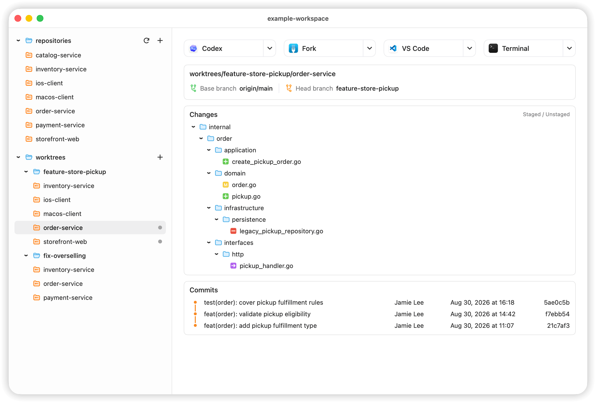

# Modu Desktop

Modu Desktop 是一款面向多仓库开发的 macOS 工作区管理工具。当开发涉及多个服务/仓库时，开发者可能需要准备多个仓库的任务分支。Modu 可以按任务组织工作树分组，在分组路径下检出相关仓库工作树，让开发者直接找到本次要处理的仓库，然后快速在外部开发工具中打开项目。



## 主要功能

- 管理工作区中的多个 Git 仓库，支持批量添加与更新。
- 创建、编辑和删除跨仓库的 Worktree Group。
- 查看工作树更改与提交，在 Agent、编辑器、终端或 Git 工具中打开当前目录。
- 通过 YAML 导入导出工作区结构，支持中文与英文界面。
- 使用配套的 `modu-cli` 和工作流 skill 管理工作区。

## 工作区如何组织

工作区本身也是 Git 仓库，可维护跨仓库共用的文档、提示词和工作流。业务仓库与任务分组按以下结构组织：

```text
example-workspace/
├── repositories/                # 主仓库的本地副本
│   ├── order-service/
│   └── storefront-web/
└── worktrees/
    └── feature-checkout/         # 一次开发任务的工作树分组
        ├── order-service/
        └── storefront-web/
```

分组根目录是工作区仓库的 linked worktree，成员目录分别是所选主仓库的 linked worktree。同一仓库可以参与多个分组，各自保留独立的工作目录与分支，并共享该仓库的 Git 数据。

创建时，分组根目录和成员使用与分组同名的分支；已有可用的同名本地分支会被复用。选中分组打开 Agent 或编辑器，即可从同一个目录处理本次任务涉及的多个仓库。

## 开始使用

当前安装包适用于 Apple Silicon Mac。可从 [Releases](https://github.com/qimaotech/modu-desktop/releases) 下载 DMG，也可从 [GitHub Actions](https://github.com/qimaotech/modu-desktop/actions/workflows/ci.yml) 的构建产物获取；打开后将 `Modu.app` 拖入 Applications。系统要求见对应发布说明。

当前为测试包，采用 ad-hoc 签名，尚未做 Developer ID 签名与 Apple 公证。

若 App 因下载隔离标记而无法打开，确认安装包来源可信后，可在终端运行以下命令移除隔离标记，再重新打开 Modu：

```bash
xattr -dr com.apple.quarantine /Applications/Modu.app
```

1. 启动 Modu，按引导安装 CLI 并选择工作区目录，首次使用建议选择专用的新目录。
2. 通过仓库 URL 添加需要协作开发的 Git 仓库，也可在添加窗口的“导入”菜单中选择本地仓库或 YAML 文件。本地导入支持多选文件夹并递归查找仓库，只列出远端可访问且具有有效默认分支的仓库；两种导入方式均可先勾选仓库，再从远端克隆到工作区。本地导入不会迁移原目录中的开发环境或未提交改动。仓库访问沿用本机 Git 认证配置，需提前准备相应访问权限。
3. 按需更新主仓库，再创建 Worktree Group（工作树分组），填写任务名称并选择本次涉及的仓库。
4. 选中分组，通过工具栏在已安装的 Agent、编辑器或终端中打开；只处理一个仓库时，选中对应成员。不同任务可保留不同分组，切换目录时保留各自的改动。
5. 在各仓库中完成开发、提交、推送和合并后，核对需要保留的内容，再清理不再需要的成员或分组。

Modu 提供工作树更改与提交查看，开发、运行及提交合并在外部工具中完成，各仓库独立操作。

## CLI 与 Agent

引导会在 `~/.local/bin` 中安装 `modu-cli` 命令入口，该目录需在登录 shell 的 `PATH` 中。在工作区根目录运行，例如：

```bash
modu-cli workspace inspect
modu-cli worktree create feature-checkout --repo order-service --repo storefront-web
```

上例需先添加对应仓库。其他目录可通过 `--workspace <工作区根目录>` 指定工作区；更多用法查看 `modu-cli --help` 及各子命令的 `--help`。

工作区安装内置工作流 skill 后，可从工作区根目录启动 Codex，通过 `$modu-workflow` 手动调用，协助管理仓库和分组。

## 使用须知

- **本地扫描**：直接选择 Git 仓库目录时，会额外检查其直接子目录；从普通目录递归发现 Git 仓库时停止向下遍历。依赖、构建产物目录和符号链接会被跳过。
- **更新主仓库**：获取远端默认分支并尝试快进本地主仓库；有本地改动或未处于默认分支时会跳过。已有分组的任务分支需自行同步基准。
- **分享结构**：在“设置 → 配置”中导出 YAML，可在空工作区中导入仓库清单和分组关系。YAML 不包含代码、提交历史或未提交改动。
- **清理任务**：删除成员或整个分组会永久移除对应工作树及其当前本地分支，包括复用的分支和未合并提交；删除主仓库还会移除关联成员，再将主仓库目录移至废纸篓。确认前请核对删除预览。
- **取消与失败**：批量操作取消或部分失败后，已完成的效果可能保留，请按结果列表核对并处理剩余项目。
- **Submodule**：当前不支持为包含 Git submodule 的仓库创建分组成员工作树。

本地构建、调试与测试见 [开发指南](docs/DEVELOPMENT.md)，版本变化见 [更新日志](CHANGELOG.md)。
