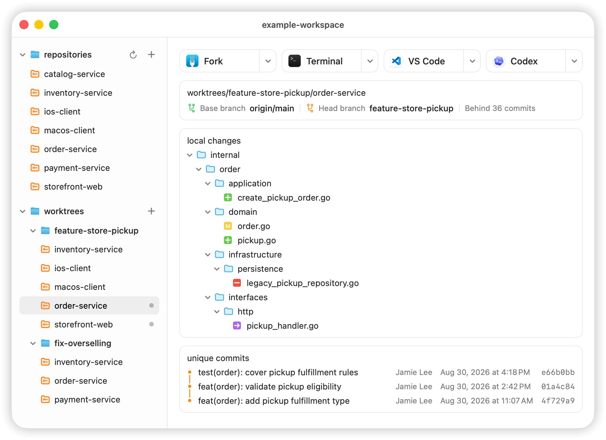

# MonoDeck

MonoDeck 是一款专为 macOS 打造的原生客户端，可按任务组织多个仓库的独立工作树，帮助开发者统一管理跨仓库开发工作区，打造专属 AI 工作流。



## 主要功能

- 管理工作区中的多个 Git 仓库，支持批量添加与更新。
- 创建、编辑和删除跨仓库的工作树分组（Worktree Group）。
- 查看工作树更改与提交，在 Agent、编辑器、终端或 Git 工具中打开当前目录。
- 通过 YAML 导入导出工作区结构，支持中文与英文界面。
- 使用配套的 `mono-deck` 和工作流技能 管理工作区。
- 通过可配置的全局快捷键显示或隐藏窗口，默认使用 `⌃⌥Z`。

## 工作区如何组织

工作区本身也是 Git 仓库，可维护跨仓库共用的文档、提示词和工作流。业务仓库与任务分组按以下结构组织：

```text
example-workspace/
├── repositories/                # 主仓库的本地副本
│   ├── order-service/
│   └── storefront-web/
└── worktrees/
    └── feature-checkout/         # 一次开发任务的工作树分组
        ├── order-service/
        └── storefront-web/
```

分组根工作树是工作区仓库的关联工作树（linked worktree），成员工作树分别关联所选主仓库。同一仓库可以参与多个分组，各自保留独立的工作目录与分支，并共享该仓库的 Git 数据。

创建时，分组根目录和成员使用与分组同名的分支；已有可用的同名本地分支会被复用。新建根目录分支从工作区当前提交开始；新建成员分支优先基于本地已知的同名远端分支，否则使用本地已知的远端默认分支。

创建分组不会自动更新主仓库，已有分组也不会自动同步工作区文档或内置工作流技能。选中分组打开 Agent 或编辑器，即可从同一个目录处理本次任务涉及的多个仓库。

## 开始使用

当前安装包适用于 Apple Silicon Mac。可从 [Releases](https://github.com/qimaotech/mono-deck/releases) 下载 DMG，也可从 [GitHub Actions](https://github.com/qimaotech/mono-deck/actions/workflows/ci.yml) 的构建产物获取；打开后将 `MonoDeck.app` 拖入 Applications。系统要求见对应发布说明。

MonoDeck 默认每天最多自动检查一次正式版本，可在更新窗口关闭。后台无新版或检查失败时不提示，发现新版后等待当前操作结束、App 处于前台时提示。也可通过 **MonoDeck → 检查更新…（Check for Updates…）** 手动检查并查看发布说明。

自动检查不会下载或安装更新。点击“安装并重启”后，MonoDeck 会下载并校验安装包，完成当前操作的退出处理后替换应用并请求启动新版，同步更新内置 CLI。原应用未能及时退出时，会显示错误并恢复为可重试状态。安装后不会自动回退旧版本；如果新版未能启动，可从原安装位置手动重新打开。应用所在文件夹需要允许当前用户写入。

当前为测试包，采用 ad-hoc 签名，尚未做 Developer ID 签名与 Apple 公证。

若 App 因下载隔离标记而无法打开，确认安装包来源可信后，可在终端运行以下命令移除隔离标记，再重新打开 MonoDeck：

```bash
xattr -dr com.apple.quarantine /Applications/MonoDeck.app
```

MonoDeck 使用独立的工作区登记、偏好和缓存，不自动迁移其他应用的数据。首次启动按全新安装引导配置。在初始设置（MonoDeck Setup）中选择目录后立即显示路径，不检查工作区；点击“继续”后统一校验并设置：已有有效登记时使用原登记，登记缺失且资源目录为空时初始化，有现有仓库或 Git worktree 时尝试恢复登记，再照常执行工作区维护。重装后也可选择原工作区按此流程恢复。

恢复只读取本地 Git 数据，不联网，保留业务主仓库、分组及成员的现有分支、暂存内容和未提交改动。仅识别标准目录中具有有效 `origin` 且仓库 ID 与目录名匹配的主仓库，以及注册和归属均匹配的分组根与成员；异常资源会被忽略并保留在磁盘上。自定义仓库显示名无法还原，分组创建时间记为恢复时间。工作区根目录仍按[工作区文件与自动提交](#工作区文件与自动提交)的规则维护托管文件。

1. 启动 MonoDeck，按引导安装 CLI 并选择工作区目录，首次使用建议选择专用的新目录。
2. 通过仓库 URL 添加 Git 仓库，或在添加窗口的“导入”菜单中选择本地仓库或 YAML 文件，勾选后从远端克隆到工作区。本地导入不迁移原目录中的开发环境或未提交改动；仓库访问沿用本机 Git 认证配置，需提前准备相应访问权限。
3. 按需更新主仓库，再创建工作树分组，填写分组名称并选择本次涉及的仓库。名称须是单个目录名且符合 Git 分支命名规则，例如 `feature-checkout`，不能包含 `/` 或空格。
4. 选中分组，通过工具栏在已安装的 Agent、编辑器或终端中打开；只处理一个仓库时，选中对应成员。不同任务可保留不同分组，切换目录时保留各自的改动。
5. 在各仓库中完成开发、提交、推送和合并后，核对需要保留的内容，再清理不再需要的成员或分组。

App 会记住各工作区的选择、侧栏展开和本地更改树折叠状态，并恢复窗口位置与布局。Git 详情先展示最近成功缓存，再按需校验本地数据；刷新失败保留仍有效的旧结果并提示，仓库身份失效时清除缓存，可按 `⌘R` 重试。同一工作区已有成功快照时，登记验证失败仍保留浏览内容，暂停 Git 读取并阻止管理操作，验证恢复后再允许执行；没有快照时显示加载错误。

主窗口的添加仓库、创建分组和外部工具按钮保持可点击，无法执行时会说明原因。添加、创建需要工作区准备完成且没有其他管理操作；外部工具只检查目标目录和工具自身是否可用，工作区准备或维护失败期间也能打开有效目录。

Git Browser 以本地 `origin/HEAD` 所指的远端追踪分支为基准，展示本地更改、当前 HEAD 的独有提交（`base..HEAD`），并通过落后提交弹出面板展示基准独有的提交（`HEAD..base`）。浏览、刷新、预加载和 CLI 查询只读取本地 Git 数据，不自动 fetch，也不获取工作区锁；需通过外部 Git 工具或“更新主仓库”同步远端。基准缺失时仍可查看文件更改；领先或落后提示不会自动合并或修改分支。开发、运行、提交与合并在外部工具中完成。

App 根据本地文件变化、重新激活和侧栏展开自动补查。启动维护结束后，后台逐步预加载已展开的主仓库、分组根和成员的完整详情，减少切换等待；当前选择始终优先。后台失败静默保留有效旧结果，退到后台或执行业务操作时暂停；侧栏查询与详情预加载不做周期扫描。

## CLI 与 Agent

引导会创建 `~/.local/bin/mono-deck` 符号链接，直接指向当前 App 内置的 CLI，该目录需在登录 shell 的 `PATH` 中。App 路径不变时，更新 App 后 CLI 会自动跟随，无需重新安装；旧版复制安装首次迁移、移动 App 后，需在引导中重新安装以修复链接。在工作区根目录运行，例如：

```bash
mono-deck workspace tree --json
mono-deck group create feature-checkout --repo order-service
mono-deck group member add feature-checkout storefront-web
mono-deck group edit feature-checkout --repo order-service --dry-run
mono-deck group delete feature-checkout --dry-run
mono-deck group delete feature-checkout --yes
```

上例需先添加对应仓库。`--repo` 和成员命令的位置参数使用仓库 ID，即仓库 URL 末段去除 `.git` 后缀后的名称；`repo add --display-name` 仅设置显示名称，不改变 ID。不同 URL 派生的同名 ID（忽略大小写）不能共存。

CLI 会从当前目录向父目录查找已登记的工作区；在工作区外运行时，通过 `--workspace <工作区根目录>` 指定。

`workspace tree` 默认输出工作区目录树，跳过失效资源，不列出代码文件。所有命令的 `--json` 均输出 schema 版本 2 的操作结果，包含 `command`、`status`、`dry-run`、`data`、`items` 和 `plan`；目录树位于 `data.tree`，节点包含 `type`、`path`、`children`，根路径为绝对路径，子路径相对父节点，叶子的 `children` 为 `null`。失败或取消也使用同一结果结构。

`repo list` 和 `group list` 通过 `items` 返回逐项状态与错误，仓库 ID 位于 `resource["repository-id"]`，分组名称位于 `resource["group-name"]`。查询和 YAML 导出只读取登记快照，不清理记录、不 fetch，也不等待工作区锁；YAML 导出保留全部已登记仓库与分组定义，不因资源失效过滤，也不包含工作区根路径。并行操作期间，查询结果不会自动修复或接管资源。

创建、添加和编辑命令默认执行。`group create` 要求分组尚不存在；已有分组通过 `group member add` 增加成员。`group edit` 的 `--repo` 是完整目标成员集合，省略的成员将被删除；`--clear-members` 删除全部成员但保留分组根工作树。`group member delete <分组名称> <仓库 ID>…` 只删除指定成员，`group delete` 删除整个分组。

所有写命令支持 `--dry-run`，只检查本地前提并返回计划，不修改工作区资源、不克隆或 fetch。仓库添加计划中的 `maintain-workspace-ignore` 表示维护 `.gitignore` 并按需提交，可能包含该文件已有的手动修改。计划中的 `actions` 是预计动作，`deletions` 包含删除目标、当前分支和风险；它们不属于已完成的 `effects`。预览不保证后续网络和文件操作成功。

涉及删除时，交互终端会请求确认；`--json` 或非交互环境必须提供 `--yes`，否则返回 `confirmation-required`，不执行任何变更。`--yes` 授权本次命令的删除目标，不能绑定较早的预览；`group delete --yes` 直接在锁内确定并删除当前目标，跳过锁外风险预览和本地更改读取。执行时仍校验目标及当前分支；`--dry-run` 优先于 `--yes`，只返回预览。延迟或外部修改后应重新预览。

桌面端和 CLI 可同时使用，App 会同步登记变化，后台或忙碌时延后处理。同一工作区的加锁操作冲突时会等待重试，超时返回 `workspace-lock-timeout`；支持取消的操作在等待时也可取消。查询和仓库更新不获取工作区锁，不同工作区的写操作使用独立锁。

CLI 提供工作区目录树、仓库列表/添加/删除、分组列表/创建/编辑/删除及成员增删；工作区初始化与切换、批量导入、更新主仓库及 YAML 导入导出通过 App 操作。旧的 `workspace inspect`、`worktree` 命令族、`repo remove`、`--name` 和 `--execute` 不再支持，完整参数见各子命令的 `--help`。

工作区登记与 YAML 格式均为版本 2：仓库显示名字段为 `display-name`，分组成员字段为 `repository-ids`。不读取或迁移旧格式；已有不支持的登记不会自动覆盖。Git 浏览缓存使用独立的 v2 目录，旧字段不作兼容解析。

工作区安装内置工作流技能后，可从工作区根目录启动 Codex，默认允许根据任务自动调用，也可通过 `$mono-deck-workflow` 显式调用，协助管理仓库和分组。创建前会确认分组名称和完整仓库列表；删除或移除成员前会检查影响范围与风险。

### 工作区文件与自动提交

MonoDeck 会自动修改以下工作区文件，并在内容相对 HEAD 有变化时自动提交到工作区根仓库：

- **`.gitignore`**：初始化、打开或重新加载工作区，以及添加或导入仓库时，按需补充忽略规则。自动提交以整个文件为范围，因此可能一并提交你的手动修改。
- **内置工作流技能**：打开或重新加载工作区时，会丢弃 `.agents/skills/mono-deck-workflow/` 下 `SKILL.md` 与 `agents/openai.yaml` 在工作树和暂存区中的未提交改动，同步内置版本并按需提交。请勿修改这两份托管文件。

启动恢复、切换工作区和手动重新加载会执行维护；维护不提供取消按钮，退出会等待收尾。登记变化、激活、展开侧栏及管理操作后的自动刷新只读，不执行维护。自动提交附带 `Auto-committed-by: MonoDeck`；请预先配置 Git 提交身份及签名环境。

需要自定义流程时，建议在工作区根目录新增 `.agents/skills/mono-deck-workflow-addon/SKILL.md`，通过独立的 `mono-deck-workflow-addon` 技能维护自定义约定与步骤。

## 使用须知

- **本地扫描**：支持多选目录，跳过依赖、构建产物和符号链接。远端优先使用 `origin`，没有时仅使用唯一远端；无法确定远端、远端不可访问或默认分支无效的仓库不会列出，也不会改试其他远端。
- **添加与导入**：普通批量导入逐项完成，后续失败不撤销已添加仓库。空工作区 YAML 导入先准备全部仓库，准备失败或取消不登记；正式写入前加锁复核，开始后可能部分成功。清理只处理本次创建的目录，清理失败或保存结果不确定时报告保留路径与实际效果。
- **工作区登记**：登记保存在本机 `~/Library/Application Support/MonoDeck/`，绑定工作区路径，不随工作区 Git 提交分享。直接移动或重命名工作区目录不会自动迁移登记。仅在初始设置中点击“继续”且本机登记缺失时尝试重建，自动回填的旧路径与手动选择的路径采用相同规则；有效登记优先使用，损坏或不支持的登记不会自动覆盖。打开或手动重新加载时会移除目录已消失的资源记录；自动刷新、CLI 查询和 YAML 导出不会清理记录，也不会自动接管磁盘上未登记的仓库或工作树。
- **Git 浏览缓存**：成功详情与历史保存在本机 `~/Library/Caches/fun.armantang.MonoDeck/RepositoryCache/v2/`，开发版与正式版隔离。缓存可删除重建，不是备份，也不参与 CLI 查询或操作安全检查；设计见[开发细则](DEVELOPMENT.md#git-读取与缓存)。
- **更新主仓库**：按本地 origin/HEAD 记录的默认分支 fetch，再直接合并对应的远端追踪引用，只允许快进；有本地改动或未处于该分支时会跳过。更新不获取工作区锁，并行操作引起的 Git 锁冲突、路径变化或分叉会按实际结果报错。已有分组的任务分支需自行同步基准。
- **分享结构**：在“设置 → 配置”中导出 YAML，可在空工作区中导入仓库清单和分组关系。YAML 不包含代码、提交历史、未提交改动或当前分支状态，不能作为备份恢复。
- **清理任务**：删除成员或整个分组会永久移除对应工作树及其当前本地分支，包括复用的分支和未合并提交；删除主仓库还会移除关联成员，再将主仓库目录移至废纸篓，并检查主仓库身份及未管理工作树。确认前请核对删除范围与需要保留的内容。
- **删除预览**：预览是当时的快照，确认执行时会加锁复核目标及当前分支。关联工作树的本地更改读取失败时显示未知状态，仍可确认删除；远端配置变化或提交不可读不妨碍清理，但路径与 Git 归属必须匹配。工作树锁定或删除失败按单项结果反馈，可能保留已完成的删除。
- **取消与失败**：批量操作取消或部分失败后，已完成的效果可能保留，请按结果列表核对并处理剩余项目。
- **Submodule**：应用变更列表忽略子模块内部修改及提交指针变化，仍显示父仓库的 `.gitmodules`、普通文件与子模块之间的类型转换及冲突。CLI 查询、更新校验和删除预览保留真实 Git 状态。当前不支持为包含 Git submodule 的仓库创建分组成员工作树。

本地构建与测试命令见 [Taskfile.yml](Taskfile.yml)，版本变化见 [更新日志](CHANGELOG.md)。
